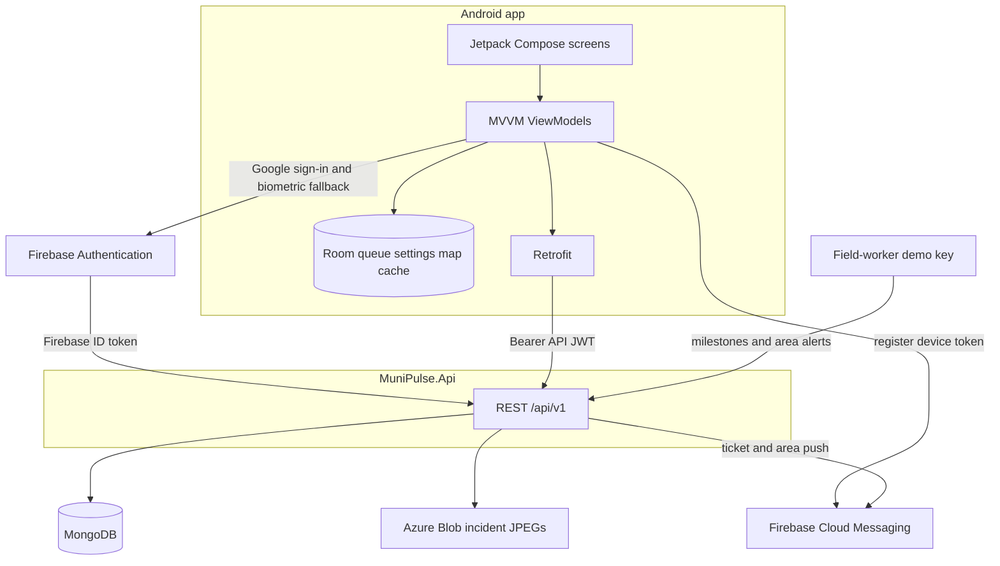

# MuniPulse SA

Citizen Service Delivery and Community Incident Tracker for South African wards. This repository is the Final POE for PROG7314 / OPSC7312, student Alton Muganda (St10263456), solo. The app version is `1.0.0` (`versionCode` 2).

## Purpose

A resident signs in with Google, reports a municipal fault with a photo and a GPS fix, and follows that report from the ward list. People upvote the same problem so it ranks as one ward signal. A field worker appends milestones. The phone can work offline, show water and evacuation points for the ward, and show an impact score that the server calculates.

## Stack

| Layer | Choice |
| --- | --- |
| Android client | Kotlin, MVVM, Jetpack Compose, Coroutines and Flow, Retrofit 2 |
| On-device store | Room for the settings mirror, the offline queue, and cached map points |
| Session | Firebase Authentication with Google SSO, then an HMAC API JWT in encrypted preferences |
| Unlock | Optional `BiometricPrompt` on a cold start, with Google sign-in as the fallback |
| Push | Firebase Cloud Messaging. The API sends ticket and ward alerts with FCM HTTP v1 |
| API | ASP.NET Core Web API on .NET 10 |
| Database | MongoDB Atlas. Collections: `users`, `incidents`, `wards`, `media`, `device_tokens`, `emergency_points` |
| Photos | JPEG upload through a 15-minute Azure Blob link |

## Architecture

The phone keeps UI state in ViewModels. Retrofit calls the API with the API JWT. Firebase Authentication is used to obtain a Google ID token. `POST /api/v1/auth/session` exchanges that token for the API JWT. Room holds only device state. MongoDB remains the record for profiles, incidents, milestones, emergency points, and push tokens. Photo bytes go to Azure Blob. A field worker publishes milestones with a field-worker JWT or the demo API key. After that save, the API may send a data-only FCM message. The phone draws the notification and opens the incident or the ward home when it is tapped.



Biometric unlock is local. It does not replace the API JWT. Marketing notifications stay on the phone and are never pushed. The emergency map does not use a map-provider key.

## Repository layout

```
android/          Jetpack Compose app (application id com.munipulse)
api/              MuniPulse.slnx and MuniPulse.Api
play-listing/     Play Store text and the screenshot folder
```

## GitHub Actions

This is one Git repository. Commit source, the Gradle wrapper, `google-services.json.example`, and `appsettings.json` with the secret fields left empty. The root `.gitignore` keeps local files out of history: `google-services.json`, `local.properties`, `*.keystore`, `appsettings.Development.json`, `App_Data/`, build output, APK and AAB files, and `CHECKLIST.md`. There is no zip of the source tree. `android/gradle/wrapper/gradle-wrapper.jar` is the Gradle wrapper, not a source dump.

Every push runs two workflows. Each job checks out the repository with read-only permission and defines no secrets. Neither workflow filters the test task, so the F3 SAS tests, the F4 sync tests, and the F7 impact tests run with the rest of the suite.

| Workflow | File | What a push runs |
| --- | --- | --- |
| API | `.github/workflows/api.yml` | .NET 10 SDK, then `dotnet test api/MuniPulse.slnx` |
| Android | `.github/workflows/android.yml` | JDK 21, Android compile SDK 37, then `:app:testDebugUnitTest` |

The API job uses the empty MongoDB connection string and the empty JWT signing key in `appsettings.json`. The Android job copies `google-services.json.example` into the gitignored Firebase file and does not call Firebase. GitHub-hosted runners do not include the Android SDK, so that job installs platform 37. It does not start an emulator.

## Setup

Keep the Atlas connection string, the Azure Storage connection string, the JWT signing key, the Firebase service account, the field-worker demo key, and `google-services.json` on your machine. The commands below use [user-secrets](https://learn.microsoft.com/aspnet/core/security/app-secrets) for the API. You can use a gitignored `appsettings.Development.json` instead, copied from `api/MuniPulse.Api/appsettings.Development.json.example`.

### MongoDB

Create a MongoDB Atlas cluster and a database user. The API database name is `munipulse`.

```powershell
dotnet user-secrets set "MongoDb:ConnectionString" "<atlas-connection-string>" --project api/MuniPulse.Api
```

On startup the API creates indexes and seeds wards `JHB-23`, `JHB-24`, `CPT-11`, `DBN-07`, and `TSH-04`, the user `demo-field-worker`, and the water and evacuation points. With an empty connection string, `/health` still returns ok and data routes return `503 DATABASE_UNAVAILABLE`.

### Azure Blob

Photo bytes are stored in the container `incident-photos`. Leave the connection string empty until you have a storage account. A report with no photo still saves. A report with photos returns `503 STORAGE_UNAVAILABLE` and is not saved.

```powershell
dotnet user-secrets set "AzureBlob:ConnectionString" "<storage-connection-string>" --project api/MuniPulse.Api
```

### JWT signing key

Session issuance needs a key of at least 32 characters.

```powershell
dotnet user-secrets set "Jwt:SigningKey" "<at-least-32-random-characters>" --project api/MuniPulse.Api
```

`Firebase:ProjectId` in `appsettings.json` is `munipulse-987ce`. It must match the Firebase project that issued the Google ID token.

### FCM service account

Ticket and area pushes use FCM HTTP v1 through the Firebase Admin SDK. Put the service-account JSON in user-secrets as one line. Leave it empty to skip sends without failing milestone or area-alert writes.

```powershell
dotnet user-secrets set "Firebase:ServiceAccountJson" "{...service-account json...}" --project api/MuniPulse.Api
```

Enable Cloud Messaging in the Firebase console for `munipulse-987ce`. Field workers trigger ward alerts with `POST /api/v1/alerts/area`. Marketing stays local and is never pushed.

### Firebase

The Android package is `com.munipulse`. `android/app/google-services.json` is gitignored. Commit `android/app/google-services.json.example` only.

1. Copy `android/app/google-services.json.example` to `android/app/google-services.json` if the downloaded file is not there yet.
2. From `android/`, run `.\gradlew.bat :app:signingReport` and register the debug SHA-1 on the Firebase Android app.
3. Enable the Google sign-in provider. That creates a Web client ID.
4. Download `google-services.json` again into `android/app/`. The file is ready for sign-in when a Web client appears under `oauth_client`.
5. Rebuild and run on a device or emulator with Google Play. Tap **Continue with Google**.

### API URL

The API http profile listens on `http://localhost:5285`. Health check: [http://localhost:5285/health](http://localhost:5285/health).

The app reads `API_BASE_URL` from `android/local.properties` (gitignored). Start from `android/local.properties.example`.

| Where the app runs | `API_BASE_URL` |
| --- | --- |
| Emulator | `http://10.0.2.2:5285/` (the default) |
| Physical phone | Your PC's LAN address, or an HTTPS tunnel |

Debug builds allow cleartext HTTP. A release build sets `usesCleartextTraffic` to false and refuses to assemble unless `API_BASE_URL` starts with `https://`.

Signing reads a gitignored keystore from `android/local.properties`:

```
RELEASE_STORE_FILE=release.keystore
RELEASE_STORE_PASSWORD=<local password>
RELEASE_KEY_ALIAS=munipulse
RELEASE_KEY_PASSWORD=<local password>
```

`android/release.keystore` is covered by `*.keystore` in `.gitignore`. Create it on this machine only. Minify stays off because Gson and Retrofit use model field names. The Play listing text is in `play-listing/`.

### Field-worker demo path

There is no staff app. API startup seeds Firebase uid `demo-field-worker` with role `FieldWorker` once MongoDB is configured.

```powershell
dotnet user-secrets set "FieldWorker:DemoApiKey" "<long-random-demo-key>" --project api/MuniPulse.Api
```

Choose that value yourself and leave it out of git. Create an incident, copy its id, then send the milestone call in `api/MuniPulse.Api/MuniPulse.Api.http` with header `X-Demo-Api-Key`. Types are `Assigned`, `OnSite`, `Resolved`, and `Note`. A citizen API JWT on that route, without the header, receives `403 FORBIDDEN`. A missing token receives `401`.

A Development host can also accept session aliases `dev-citizen` and `dev-field-worker` when `Auth:AllowDevBypass` is true. Copy the Development example to `appsettings.Development.json`. Those aliases are refused outside Development.

## How to run

### API

Requires the .NET 10 SDK.

```powershell
dotnet run --project api/MuniPulse.Api --launch-profile http
dotnet test api/MuniPulse.slnx
```

`dotnet test` covers create validation, SAS request validation, the sync push contract, the 250 metre duplicate window, push preference and copy, the emergency-point seed, impact score rules, a citizen token that cannot write a badge, the field-worker key comparison, and unauthenticated calls. The tests do not need Firebase, MongoDB, Azure, a map key, or a JWT signing key. The API workflow runs the same command on every push.

Health check: [http://localhost:5285/health](http://localhost:5285/health)

```json
{ "status": "ok", "app": "MuniPulse SA" }
```

### Android

Open `android/` in Android Studio (AGP 9.4, Gradle 9.6, compile SDK 37). Studio writes `sdk.dir` into `android/local.properties`. Set `API_BASE_URL` as described above.

```powershell
cd android
.\gradlew.bat :app:testDebugUnitTest
```

That task runs the incident form validator, language codes, biometric availability, the offline queue, and the sync conflict rule. It does not need Firebase, MongoDB, or a device. The Android workflow runs the same task on every push.

## Domain API

Routes live under `/api/v1`. Failures use the planning error envelope (`error.code`, `message`, `fields`, `correlationId`). `/health` does not need the database. Data routes return `503 DATABASE_UNAVAILABLE` until `MongoDb:ConnectionString` is set.

| Method | Path | Auth |
| --- | --- | --- |
| POST | `/api/v1/auth/session` | Firebase ID token in the body. The API checks it against Google's securetoken certificates, then returns an API JWT. |
| GET, PATCH | `/api/v1/me` | Bearer API JWT. PATCH accepts ward, language, and notification switches. `impactScore`, `score`, and `badges` are refused with `403 BADGE_FORBIDDEN`. |
| GET | `/api/v1/me/impact` | Bearer API JWT. Returns `score`, `badges`, `reportsCount`, and `upvoteCount` calculated on the server. A user with no reports gets zeros. |
| POST | `/api/v1/me/badges` | Bearer API JWT. Always `403 BADGE_FORBIDDEN`. A citizen cannot award `VerifiedReporter`. |
| POST | `/api/v1/media/sas` | Bearer API JWT. Body is `contentType` (`image/jpeg`) and `byteSize` (1 to 5 MB). Returns `photoId`, `uploadUrl`, and `expiresAt`. The link lasts 15 minutes. The app uploads the JPEG to that URL. |
| POST | `/api/v1/sync/push` | Bearer API JWT. A batch of 1 to 20 queued `createIncident` operations. Each result is `ack` or `conflict`. Photos are uploaded with the media link first. |
| POST, DELETE | `/api/v1/devices/fcm-token` | Bearer API JWT. POST body is `token` and `platform` (`android`). DELETE removes that user's tokens. Sign-out calls DELETE. |
| POST, GET | `/api/v1/incidents` and `/api/v1/incidents/{id}` | Bearer API JWT. Detail photos include a short-lived read URL when the blob is recorded. Detail includes the stored latitude and longitude. |
| GET | `/api/v1/emergency/points` | Bearer API JWT. Query `wardCode`. Returns seeded water and evacuation points for that demo ward. |
| GET | `/api/v1/incidents/aggregates` | Bearer API JWT. Open reports in the ward, grouped when they share an `aggregateId`. |
| GET | `/api/v1/incidents/nearby` | Bearer API JWT. Open reports in the same ward and category within 250 metres and 14 days. |
| POST | `/api/v1/incidents/{id}/upvotes` | Bearer API JWT. One vote per user. |
| POST | `/api/v1/incidents/{id}/milestones` | FieldWorker role, or header `X-Demo-Api-Key`. Appends Assigned, OnSite, Resolved, or Note. After save, may send a ticket-status push when the reporter's preference is on. |
| POST | `/api/v1/alerts/area` | FieldWorker role, or header `X-Demo-Api-Key`. Body `{ "wardCode", "note" }`. Pushes an area alert to users with that default ward and area emergencies on. |

Demo wards: `JHB-23`, `JHB-24`, `CPT-11`, `DBN-07`, `TSH-04`. Categories: `Pothole`, `WaterLeak`, `IllegalDumping`, `Streetlight`, `Sewage`, `Other`.

A new report joins an open report in the same ward and category when it is within 250 metres and 14 days. Both then share an `aggregateId`. Sending the same `clientMutationId` again returns `409 DUPLICATE_MUTATION` and does not create a second incident. Sample calls are in `api/MuniPulse.Api/MuniPulse.Api.http`.

Logs record the user id, the HTTP method, path, status, and correlation id. They record an exception type when something fails. They do not record tokens, connection strings, coordinates, or descriptions.

### Impact score (UD-5)

`GET /api/v1/me/impact` counts the signed-in user's stored reports and the upvotes already on those reports. The client does not send a score.

| Rule | Value |
| --- | --- |
| Each report | 10 points |
| Each upvote received | 2 points |
| `FirstReport` | At least one report |
| `CommunityVoice` | At least 5 upvotes received |
| `VerifiedReporter` | Staff role (`FieldWorker` or `WardLead`) and at least one report |

A citizen account never receives `VerifiedReporter` from this calculation. `POST /api/v1/me/badges` and a profile patch that includes a score or badges return `403 BADGE_FORBIDDEN`. The result is saved on the user document after it is calculated.

## Android app

Cold start stays on the splash while the saved session is checked. A valid session opens Home. If biometric unlock is on, that gate appears first. Success opens Home. Failure stays on the gate. Google sign-in is the fallback. With no session, first launch shows three onboarding pages, then Google sign-in. Sign-out returns to sign-in and does not show those pages again.

Home is the ward pulse. **Report** is on that screen, so a signed-in person reaches it in one tap. The bottom bar is Home, My, Map, and Settings. Map opens the emergency points for the current ward. **Navigate cached** opens the last points saved in Room when the phone is offline or the load fails. The screen says the points are not for 112 or live dispatch. Empty and failed loads use the same empty, loading, and retry pattern as the other lists, in English and isiZulu.

**My** lists this account's reports. A row opens the incident: status, description, photos, upvote, timeline, and the stored location. **Upvote** adds one vote. A second vote returns `409 ALREADY_UPVOTED`. Settings holds the ward, language (`en` or `zu`), notification switches, biometric switch, sync centre, privacy note, and sign-out. Profile shows the name, masked email, ward, language, role, score, badges, report count, and upvotes received. A user with no reports sees zero.

The report form checks the category, a description of 10 to 1000 characters, a latitude and longitude, accuracy when a fix has one, the ward, and at most three photos. Invalid input stays on the screen. With no network, a valid report is stored on the phone and the form says it is queued. **Sync now** uploads queued photos and calls `POST /api/v1/sync/push`. A resolved report keeps the server description when a queued edit conflicts with it.

After sign-in the app registers an FCM token. Sign-out deletes it. A ticket push opens that incident. An area push opens Home for that ward. Copy is English or isiZulu from the profile language.

Protected routes return `401 UNAUTHENTICATED` when the token is missing and `401 INVALID_TOKEN` when it is invalid or expired.

## Screenshots

Take these on a physical phone and save the PNG files in `play-listing/screenshots/`. The folder is listed in the repository. The image files are added after that device run.

| File | Screen |
| --- | --- |
| `01-sso.png` | Google sign-in |
| `02-settings.png` | Settings, including the privacy note |
| `03-report.png` | Create report |
| `04-offline-sync.png` | Sync centre with a queued report, or after reconnect |
| `05-map.png` | Emergency map for a demo ward |

## Release notes

Changes since the Part 2 prototype. UD-4 and UD-5 are the two features added for this version.

| Area | What changed |
| --- | --- |
| Language | English and isiZulu for the visible screens, including empty and error copy. The choice is saved with `PATCH /api/v1/me`. |
| Biometric unlock | Optional cold-start gate. Google sign-in remains the fallback. |
| Photos | Incident JPEGs upload through `POST /api/v1/media/sas` to Azure Blob. A missing storage account does not save a report that includes photos. |
| Offline sync | Room queue, sync centre, and `POST /api/v1/sync/push`. The same client mutation is acknowledged. A queued edit does not reopen a resolved report. |
| Push | Device token registration, ticket-status pushes, and ward area alerts. Marketing is not pushed. A missing service account skips the send and still saves the milestone. |
| UD-4 Emergency map | `GET /api/v1/emergency/points` returns seeded water and evacuation points. The map draws them on the phone. **Navigate cached** uses the Room copy. Incident detail shows the stored location. |
| UD-5 Impact score | `GET /api/v1/me/impact` returns the server score, badges, report count, and upvote count. A citizen cannot write `VerifiedReporter`. |
| Release | Version `1.0.0`. Launcher icon is a pulse ring, municipal shield, and centre pin. Play listing text is in `play-listing/`. |

## Demo video

**Demo video: TBD**
